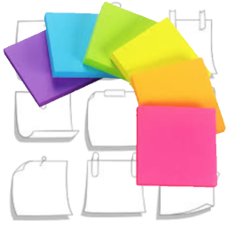
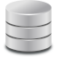
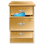

<head> <link rel="icon" href="favicon.ico" /> </head>

<!-- ~~~~~~~~~~~~~~~~~~~~~~~~~~~~~~~~~~~~~~~~~~~~~~~~~~~~~~~ -->

 

----------------------------------------------------------------

# Owl Notes Menu

----------------------------------------------------------------

 

# Drive Index Pages

----------------------------------------------------------------

> [Drive Index Example](./drive-index-example.html)
> [Drive Index Omega](./drive-index-omega.html)

----------------------------------------------------------------

 

# SQL Lite

----------------------------------------------------------------

> [SQL Lite Examples](./sqlite-examples.html)

----------------------------------------------------------------

 

# EBooks

----------------------------------------------------------------

> [Owl Concept](./owl-concept.pdf)
> [Owl Examples](./owl-examples.pdf)
> [Owl Ideas](./owl-ideas.pdf)
> [Owl Usage](./owl-usage.pdf)

----------------------------------------------------------------

 

# Dot Rockets

----------------------------------------------------------------

> [Dorothy's Friends](./dot.html)
> [Express Lane](./express-lane.html)

----------------------------------------------------------------

 

# Files for Download

----------------------------------------------------------------

## List Files

> [EBook List](./ebook.list)
> [Explore List](./explore.list)
> [Concept List](./concept.list)
> [File List](./file.list)
> [Folder List](./folder.list)
> [List of Lists](./list.list)
> [Markdown List](./markdown.list)
> [Mindmap List](./mindmap.list)
> [Page List](./page.list)

----------------------------------------------------------------

## Markdown Files

> [Drive Index Example](./drive-index-example.md)
> [Drive Index Omega](./drive-index-omega.md)
> [Notes Menu](./notes-menu.md)
> [SQL Lite Examples](./sqlite-examples.md)

----------------------------------------------------------------

## Mind Map Files

> [Owl Mind Map](./owl.mm)

----------------------------------------------------------------

## Concept Documents

> [Owl Concept](./owl-concept.odt)
> [Owl Examples](./owl-examples.odt)
> [Owl Ideas](./owl-ideas.odt)
> [Owl Usage](./owl-usage.odt)

----------------------------------------------------------------

## Plain Text Files

> [File Tree Text](./tree.txt)

----------------------------------------------------------------

 

# File System ( LAN Only! )

----------------------------------------------------------------

> [Workspace](./)
> [File Tree](./tree.php)

----------------------------------------------------------------

 

# Editions

----------------------------------------------------------------

[me-morpheus]:  <https://nyteowldave.github.io/owl/notes/notes-menu.html>  "Morpheus Edition"

[me-omega]:  <http://dave-omega/app/morpheus/owl/notes/notes-menu.html>  "Omega Edition"
[me-tower]:  <http://dave-tower/app/morpheus/owl/notes/notes-menu.html>  "Tower Edition"
[me-legacy]: <http://dave-legacy/app/morpheus/owl/notes/notes-menu.html> "Legacy Edition"
[me-owl]:    <http://dave-owl/app/morpheus/owl/notes/notes-menu.html>    "Owl Edition"

## Public

> [`🟢` Morpheus][me-morpheus]

## Private ( LAN Only! )

> [`🟢` Omega][me-omega]
> [`⛔` Tower][me-tower]
> [`⛔` Legacy][me-legacy]
> [`⛔` Owl][me-owl]

----------------------------------------------------------------

Updated ~ 2026-OCT-18 ~ Omega

  <button onclick="updated()">Accept</button>

----------------------------------------------------------------

<!-- ~~~~~~~~~~~~~~~~~~~~~~~~~~~~~~~~~~~~~~~~~~~~~~~~~~~~~~~~ -->

<!-- ~~~~~~~~~~~~~~~~~~~~~~~~~~~~~~~~~~~~~~~~~~~~~~~~~~~~~~~ -->

<!-- ~~~~~~~~~~~~~~~~~~~~~~~~~~~~~~~~~~~~~~~~~~~~~~~~~~~~~~~ -->

