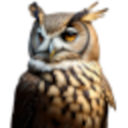

<head> <link rel="icon" href="favicon.ico" /> </head>

<!-- ~~~~~~~~~~~~~~~~~~~~~~~~~~~~~~~~~~~~~~~~~~~~~~~~~~~~~~~ -->

[tk-001]: <./dot/daves-notes.html> "Dave's Notes"
[tk-002]: <./dot/dot.html> "Dorothy's Friends"
[tk-003]: <./dot/morpheus.html> "Morpheus"
[tk-004]: <./dot/athena.html> "Athena"
[tk-005]: <./dot/caspar.html> "Caspar"
[tk-006]: <./dot/venus.html> "Venus"
[tk-007]: <./dot/snek.html> "Snek"
[tk-008]: <./dot/key-magic.html> "Key Magic"

----------------------------------------------------------------

 

----------------------------------------------------------------

# `🦉` Owl Help

----------------------------------------------------------------

> [Morpheus](https://nyteowldave.github.io/owl/owl-help.html)
> [Project Notes](https://nyteowldave.github.io/owl/owl-notes.html)
> [System Test](https://nyteowldave.github.io/owl/test.html)

----------------------------------------------------------------

# `🗒️` Usage Notes

----------------------------------------------------------------

- ( pending )

----------------------------------------------------------------

# `📪` Mail

> [`📨 ` Send Mail](mailto:nyteowldave@proton.me)
> [`📧` Read Mail](https://mail.proton.me/u/1/inbox)

----------------------------------------------------------------

# `🧰` Toolkit

> [`🛠️` Dave's Notes][tk-001]
> [`🛠️` Dorothy's Friends][tk-002]

> [`🛠️` Morpheus][tk-003]
> [`🛠️` Athena][tk-004]
> [`🛠️` Caspar][tk-005]
> [`🛠️` Venus][tk-006]
> [`🛠️` Snek][tk-007]

> [`🛠️` Key Magic][tk-008]

----------------------------------------------------------------

<!-- ~~~~~~~~~~~~~~~~~~~~~~~~~~~~~~~~~~~~~~~~~~~~~~~~~~~~~~~ -->
